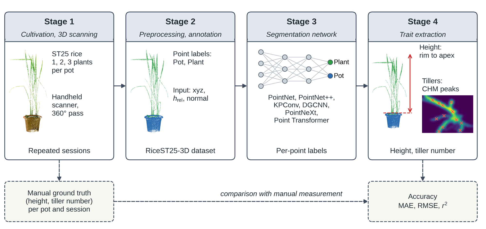
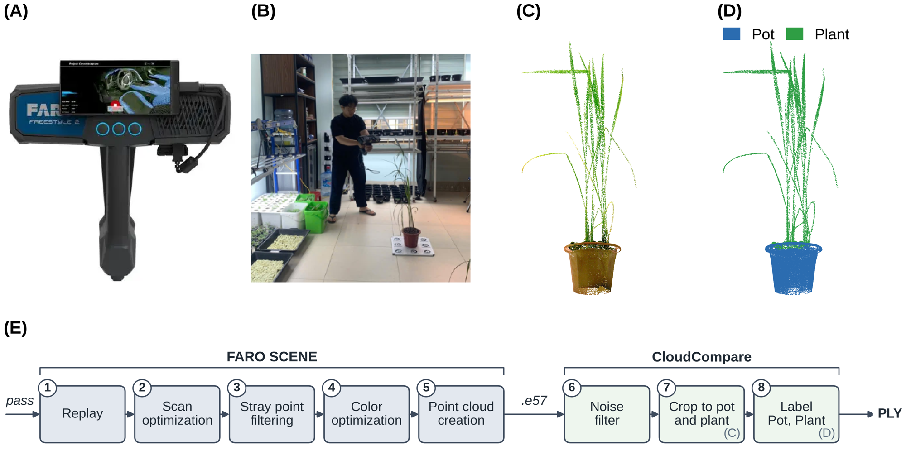

<h1 align="center">RiceST25-3D: A Handheld 3D Point Cloud Dataset and Deep Learning Pipeline for Non-Destructive Rice Phenotyping</h1>

<p align="center">
Quang Hung Ha, Son Tung Nguyen, Truong Son Nguyen, Truong Trinh Phung, Minh Quan Nguyen, Minh Trien Pham, Le Khanh Nguyen, Ha Duc Chu
<br>
VNU University of Engineering and Technology · Sejong University · PTIT · VinUniversity
</p>

<p align="center">Paper: under review &nbsp;|&nbsp; Dataset: coming soon (Zenodo DOI to be minted upon acceptance)</p>

<p align="center"></p>

This repository contains the code of the RiceST25-3D pipeline. A handheld structured-light scan of one potted
ST25 rice plant is segmented into **Pot** and **Plant** with a DGCNN, then two traits are measured from the
segmented cloud: **plant height** (pot rim to highest leaf tip, scaled by the known 14.7 cm pot height) and
**tiller number** (local maxima of an 8 mm canopy height model).

> **Abstract.** RiceST25-3D contains 255 handheld scans of 13 pots of rice cultivar ST25 (1-3 plants per pot, 20
> sessions, April-May 2026), labeled point by point into pot and plant and paired with same-session manual
> height and tiller measurements. Among six segmentation networks, DGCNN reaches 93.5 ± 0.8 % mIoU (93.7 ± 1.7 %
> leave-one-pot-out). On all 255 scans, each processed by a model that had not seen its pot, plant height has an
> MAE of 3.41 cm (r² = 0.93); tiller counting is a first baseline (MAE 6.2, r² = 0.10) and overcounts as leaves
> elongate and plants lodge.

## Updates

- Code for segmentation, height and tiller extraction, training and the 255-scan reproduction is released.
- Dataset and pretrained weights: to be released (see [Data](#data-preparation) and [Pretrained weights](#pretrained-weights)).

## Installation

```bash
git clone https://github.com/hungha1512/RiceST25-Extraction-Pipeline.git
cd RiceST25-Extraction-Pipeline

conda env create -f environment.yml     # or: pip install -r requirements.txt
conda activate ricest25
```

Python 3.10+, PyTorch 2.2+. A CUDA GPU is used automatically (`inference.device: auto` in
`configs/default.yaml`); on CPU one 274k-point scan takes minutes. `open3d` (normals as in the original
notebook) and `pye57` (raw `.e57` input) are optional. Check the install with `pytest` (needs no data or GPU).

## Data preparation

<p align="center"></p>

Place the labeled PLY files of RiceST25-3D in `data/RiceST25-3D/`:

```
data/
├── RiceST25-3D/
│   ├── C1.1_26410.ply        # <pot>_<day code>.ply ; 26410 = 10 April 2026, 2658 = 8 May 2026
│   ├── C1.1_26413.ply
│   └── ...                   # 255 scans, 13 pots (C1.x: 1 plant, C2.x: 2, C3.x: 3)
├── ground_truth.csv          # manual height (cm) and tiller count per scan (included)
└── paper_reference.json      # numbers reported in the paper (included)
```

Each PLY stores `x, y, z` and a `scalar_Plant` field that is non-NaN for Plant points and NaN for Pot points
(the CloudCompare labeling convention). Splits are by pot: `configs/split_potwise.yaml` gives the
train / val / test pots of the paper; leave-one-pot-out uses every pot once as test pot and the next pot in
sorted order as validation pot.

## Pretrained weights

Copy the checkpoints to `weights/`:

```
weights/
├── lopo/DGCNN_C1.1.pth ... DGCNN_C3.4.pth   # 13 leave-one-pot-out models
└── potwise/DGCNN_seed42.pth                  # model of the pot-wise split (optional)
```

A checkpoint is a plain `state_dict` of `DGCNNSeg(num_classes=2, in_channel=7, k=20)` (1.54 M parameters).
Class 0 is Pot, class 1 is Plant.

## Usage

### Reproduce the trait results (255 scans)

```bash
python reproduce.py --data data/RiceST25-3D --weights weights/lopo --output outputs/reproduce
```

Every scan is processed by the leave-one-pot-out checkpoint that did not see its pot. The script resumes per
pot and writes `scan_results.csv`, `report.md` (this run next to the paper, with 95 % bootstrap intervals over
pots), `table_vi_height_by_group.csv`, `table_vii_tillers.csv` and `height_oof_calibrated.csv`.
To rebuild the report from an existing CSV, without data or GPU:

```bash
python reproduce.py --report_only outputs/reproduce/scan_results.csv
```

### Evaluate segmentation

```bash
python eval_seg.py --data data/RiceST25-3D --checkpoint weights/potwise/DGCNN_seed42.pth
python eval_seg.py --data data/RiceST25-3D --checkpoint weights/lopo/DGCNN_C1.3.pth --pots C1.3
```

### Extract height and tillers from your own scans

```bash
python extract.py scan.ply --checkpoint weights/lopo/DGCNN_C1.1.pth --output outputs/my_scan --save_segmented
```

The input is one cropped, denoised `.ply` / `.e57` with a single pot and plant, vertical axis along +z, in
metric units, containing the pot bottom, the rim and the plant top. The output `extract.csv` lists plant height
(cm) and tiller count; `--save_segmented` also writes `<name>_segmented.ply` (per-point `label`) and the CHM.

### Training

```bash
python train.py --data data/RiceST25-3D --output outputs/train                 # pot-wise split
python train.py --data data/RiceST25-3D --output outputs/lopo --lopo           # 13 folds
python train.py --data data/RiceST25-3D --mode xyz                             # 3D / 4D (xyz_h) ablation input
```

Adam (lr 1e-3, weight decay 1e-4), cosine schedule, batch of 8 × 4096 points, weighted cross-entropy, early
stopping on validation mIoU (Table II of the paper). All parameters live in `configs/default.yaml`; pass your
own file with `--config`. Only DGCNN is implemented here, not the five comparison networks.

## Results

Reported in the paper (DGCNN, leave-one-pot-out, 255 scans, each scan processed by a model that did not see its pot):

| | MAE | RMSE | r² | Bias |
|---|---:|---:|---:|---:|
| Plant height (cm) | 3.41 | 4.90 | 0.93 | −3.08 |
| Plant height, constant offset removed (cm) | 2.69 | | | |
| Tiller number | 6.19 | 8.13 | 0.10 | +3.37 |

Segmentation on the 60 test scans (7D input, mean ± SD over three runs): DGCNN 93.50 ± 0.82 mIoU, PointNet++ 92.91,
PointNeXt 92.46, KPConv 90.84, Point Transformer 89.22, PointNet 87.96. Leave-one-pot-out DGCNN: 93.72 ± 1.71.

The ~3 cm height bias comes from the reference: the tape starts at the substrate, the pipeline at the pot rim.
Tiller counting from a canopy height model is a baseline; it counts leaf tips instead of tillers in May and on
lodged plants. See the paper for the analysis.

## Repository structure

```
├── reproduce.py        # 255-scan out-of-fold evaluation and report
├── extract.py          # height + tillers for your own scans
├── eval_seg.py         # segmentation mIoU of a checkpoint
├── train.py            # DGCNN training (pot-wise split or --lopo)
├── inference.py        # whole-cloud voting and the model -> traits step
├── models/dgcnn.py     # DGCNN and checkpoint loading
├── phenotyping/
│   ├── height.py       # DBSCAN clean-up, pot-rim height (Section IV-C)
│   └── tillers.py      # canopy height model + local maxima (Section IV-D, Algorithm 1)
├── datasets/rice.py    # 4096-point training / evaluation samples
├── utils/              # config, point-cloud I/O, features, metrics, report
├── configs/            # default.yaml (all parameters), split_potwise.yaml
├── data/               # ground truth table, paper reference numbers
├── weights/            # place checkpoints here
├── assets/             # figures
└── tests/              # unit tests on synthetic clouds
```

## Notes on reproducibility

- Whole-cloud inference shuffles the points into 4096-point groups and adds 3 random groups; this is seeded
  (`inference.seed`), so runs are deterministic here but not bit-identical to the original Kaggle notebook.
  Expect differences in the last digit of the reported metrics, not in the conclusions.
- Normals use the PLY's `nx, ny, nz` if present, otherwise Open3D (or a NumPy fallback) with k = 20.
- Do not tune the percentile, DBSCAN or CHM parameters on the evaluation scans.
- Tiller counting uses all Plant points without DBSCAN, as in the evaluated notebook run.

## Citation

The paper is under review. Until it is published, please cite the repository:

```bibtex
@misc{ha2026ricest25,
  title  = {RiceST25-3D: A Handheld 3D Point Cloud Dataset and Deep Learning Pipeline for Non-Destructive Rice Phenotyping},
  author = {Ha, Quang Hung and Nguyen, Son Tung and Nguyen, Truong Son and Phung, Truong Trinh and Nguyen, Minh Quan and Pham, Minh Trien and Nguyen, Le Khanh and Chu, Ha Duc},
  year   = {2026},
  note   = {Under review. Code: https://github.com/hungha1512/RiceST25-Extraction-Pipeline}
}
```

## Acknowledgements

The segmentation network follows [DGCNN](https://github.com/WangYueFt/dgcnn) (Wang et al., 2019). Point clouds
were acquired with a FARO Freestyle 2 scanner, registered in FARO SCENE and cropped, denoised and labeled in
[CloudCompare](https://www.cloudcompare.org/). Surface normals use [Open3D](http://www.open3d.org/).
